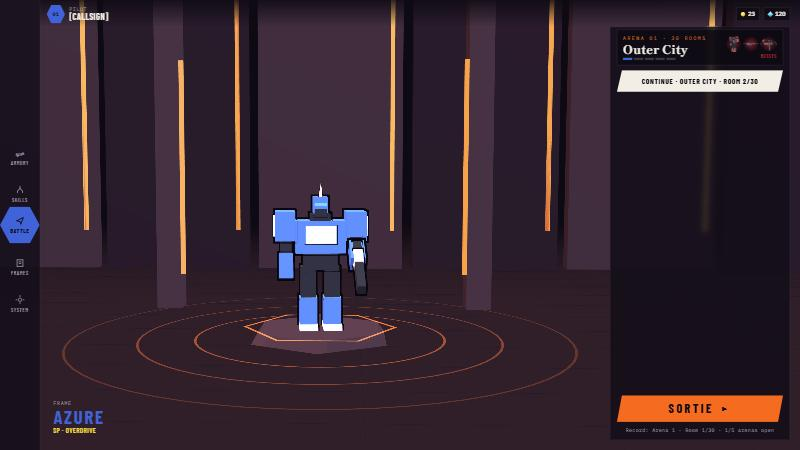
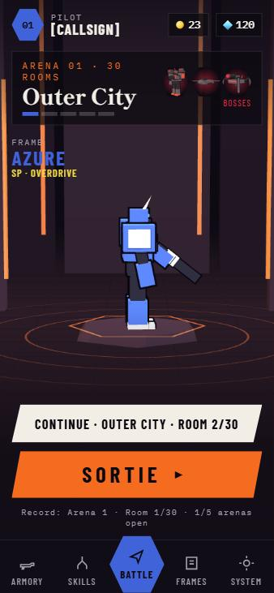
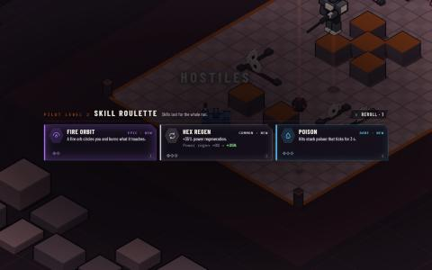
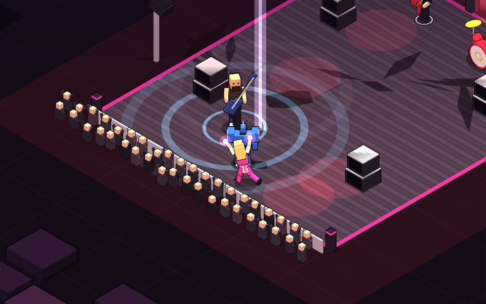
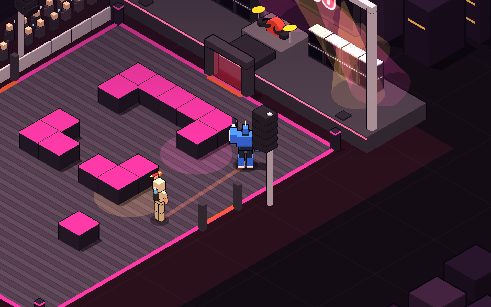

<h1 align="center">AUTOCRAT</h1>

<p align="center">
  <b>Anime tarzı mecha aksiyon roguelite.</b> Ezilen bir robot-insan dünyasını savunmak için savaşır; güçlendikçe güç onu zehirler ve sonunda kendi ırkına döner.<br>
  Tarayıcıda çalışır, kurulum yok. Bilgisayarda ve telefonda kendine özgü kontrollerle oynanır.
</p>

<p align="center">
  <a href="https://selameddin00.github.io/seraph-breaker/"><b>▶ HEMEN OYNA</b></a>
  &nbsp;·&nbsp; <a href="#kontroller">Kontroller</a>
  &nbsp;·&nbsp; <a href="CONTRIBUTING.md">Katkı ver</a>
</p>

<p align="center">
  
</p>

<p align="center">
  
  &nbsp;
  
</p>

> **© 2026 Selameddin Tirit. Tüm hakları saklıdır.** Autocrat ticari bir oyun projesidir; kaynak kodu okunabilsin ve katkı verilebilsin diye açık duruyor, ama açık kaynak **değildir**. Kopyalamak, adını değiştirip yayınlamak ya da üzerinden para kazanmak yasaktır. Ayrıntı: [Telif ve lisans](#telif-ve-lisans).
>
> Katkılar memnuniyetle karşılanır: nasıl katkı vereceğin [CONTRIBUTING.md](CONTRIBUTING.md) dosyasında, katkıya açık işler [yol haritasında](https://github.com/selameddin00/seraph-breaker/issues/80).

---

## İçindekiler

- [Bir bakışta](#bir-bakışta)
- [Üç frame](#üç-frame)
- [Beş arena](#beş-arena)
- [Main Stage ve High-Co (tester'a özel)](#main-stage-ve-high-co-testera-özel)
- [Bir koşunun anatomisi](#bir-koşunun-anatomisi)
- [Düşmanlar ve bosslar](#düşmanlar-ve-bosslar)
- [Hangar ve kalıcı ilerleme](#hangar-ve-kalıcı-ilerleme)
- [Kontroller](#kontroller)
- [Bilgisayarında çalıştır](#bilgisayarında-çalıştır)
- [Tester araçları](#tester-araçları)
- [Telif ve lisans](#telif-ve-lisans)

---

## Bir bakışta

| | |
|---|---|
| 🤖 **3 frame** | Azure, Crimson, Verdant. Her birinin kendi silahı, kendi özel hareketi ve kendi cooldown'u var. |
| 🏙️ **5 arena** | The Low City'den Fallen Sky'a, sonra anomalilerin gediği Hex Breach. Her arena biraz daha zor; açtığın her arena gücünün tavanını da yükseltir. |
| 🎰 **Yetenek ruleti** | Level atladıkça 3 kart slot makinesi gibi döner. 40'tan fazla yetenek ve 4 evrim var. Takılı silahta işe yaramayan kart hiç gelmez. |
| 👹 **8 boss + corrupted sürümleri** | Sinematik girişler, okunabilir saldırılar, Retry boss. |
| 🏗️ **3D hangar** | Mech'in platformda, ışıklar seçtiğin arenanın renginde. Masaüstünde yan menülü, telefonda tek sütunlu. |
| 💎 **Kalıcı ilerleme** | Elmasla yetenek ağacı, silah, gadget ve yeni frame. Altınla Core ve kozmetik. Core ve ağacın üst basamakları açtığın arenalarla açılır. |
| 🎵 **Canlı müzik** | Tarayıcıda üretilen metal. |
| 📱 **Telefonda iki tutuş** | Bilgisayarda WASD ve fare. Telefonu yan tut: çift çubuk, tam ekran, bilgisayarla aynı kurallar. Dik tut: Archero tarzı joystick ve otomatik ateş. |

---

## Üç frame

Her frame'in kendi zırhı, hızı, imza silahı ve özel hareketi var. Özel hareket hasarla değil **sabit bir cooldown** ile dolar. Bitince yeniden sayar. Sync kartları ve ağaçtaki Sync amplifier hızlandırır, perfect dodge %15 kazandırır, Sync Reactor odaya %30 dolu başlatır.

| | **Azure** · Type-00 | **Crimson** · Type-02 | **Verdant** · Type-01 |
|---|---|---|---|
| Rol | Hızlı tüfek, her mesafede tutarlı | Saçma topu, yakın dövüş | Delici mızrak, ağır ve dayanıklı |
| Zırh / hız | 100 / 8.6 | 100 / 10.4 | 140 / 7.6 |
| İmza silahı | 0.10 s'de bir mermi | 0.6 s'de 5 saçma, kısa menzil (~9 birim) | 0.42 s'de dev, delici bir mermi |
| Özel hareket | **Overdrive** (25 s): 5 s boyunca 2.5× atış hızı, +%30 hasar, delme, +%20 hız | **Crimson Nova** (10 s): hedefe sıçrar, havada ölümsüz, inişte r=7 patlama | **Judgement Lance** (28 s): 2.4 s dev ışın, düşmanları yakar, mermileri siler |
| Açılış | Baştan açık | 500 💎 | 500 💎 |

- **Atış hızı ekranın Hz'inden bağımsız.** 30 Hz, 60 Hz ya da 144 Hz ekranda her silah aynı hızda ateş eder.
- Mağazadan alınan 6 silah her frame'e takılabilir: Plasma Torch, Vibro Blade, Rail Lance, Arc Caster, Swarm Pod, Singularity Cannon.

---

## Beş arena

| # | Arena | Oda | Kural | Bosslar |
|---|---|---|---|---|
| 1 | **Siege · The Low City** | 30 | Eğitim alanı; melekler şehri işgal ediyor | Ophanim Throne · Prism Angel · The Last Seraph |
| 2 | **Undertow · Night Harbor** | 40 | Düşman mermileri %15 hızlı; ilk makineler | Prism Angel · Siege Arachne · Hive Carrier |
| 3 | **Ascent · Heaven's Gate** | 50 | Elitler ikili gelir | The Last Seraph · Ophanim Throne · Archon |
| 4 | **Hubris · Fallen Sky** | 50 | Kendi ırkın: makineler, bozulmuş elitler, 2 rastgele modifier | Iron Colossus · Hive Carrier · Siege Arachne |
| 5 | **Breach · Hex Breach** | 50 | Her düşman hex mutasyonlu gelebilir, elitler hep öyle gelir; Cellmite sürüleri birleşip Cell Brute olur, Hex Bulwark mermiyi geri yollar | Corrupted Colossus · Corrupted Archon · Corrupted Arachne |

- **Arena boyutları:** Bilgisayarda ve yan tutulan telefonda odalar 28 × 36 birim, iki yanda boş kaçış koridorları var. Dik telefonda okunabilirlik için 20 × 30.
- **Zorluk eğrisi:** Düşmanların canı ve hasarı, o arenayı açmış bir pilotun gücünden hesaplanır; her arena bir öncekinden biraz daha zordur, düşman mermileri de arena arena hızlanır. Eski bir arenaya dönersen kolay gelir.
- **Spawn kuralı:** Düşmanlar pilota en az 8 birim uzakta doğar. Pusu odalarında en az 6 birim arkada ya da yanda doğarlar ve önce kırmızı bir halka yanar.
- **Tuzaklar:** Haritadaki `~` hücreleri. The Low City'de testere rayları, Night Harbor'da diken karoları, Heaven's Gate'te kutsal ışık sütunları, Fallen Sky'da hepsi karışık. Önce yanıp sönerler, sonra vururlar. Düşmanlara da zarar verirler.
- **Tehlikeler:** 2. arenadan itibaren bazı odalarda ateş menfezleri ve çöken zeminler var.
- **Farm kuralı:** En yüksek açık arenanın altındaki bir arenayı tekrar oynarsan ödüller azalır: bir alt arena %60, iki ve daha alt %30.

---

## Main Stage ve High-Co (tester'a özel)

<p align="center">
  
  &nbsp;
  
</p>

High-Co'nun gece festivali: koyu sahne zemini, dev ekranlar, hoparlör kuleleri, pembe ve kehribar ışıklar, kenarda kalabalık. Robot yok, kadronun tamamı insan.

- **Erişim:** Main Stage hikayeden çıktı; sadece tester koduyla görünür (Hex Breach'ten sonra açılır). Kod proje sahibinde, repoda sadece SHA-256 özeti var.
- **Dalga odaları:** 15 odanın hepsinde dalgalar kapılardan girer. Dalga sayısı 3'ten 7'ye çıkar.
  - İlk odalar *Sound check*: tek grup üyesi ve sahne ekibi.
  - Ortada *Moshpit* sürüleri.
  - Son odalar *Encore*: dört müzisyen aynı anda sahnede.
  - Level cap 30. High-Co'dan önce %50 backstage tamiri var.
- **Ritim senkronu:** Bütün mob saldırıları canlı müziğin vuruşuna kilitli. Vuruşta atılan dash'in mükemmel kaçış penceresi iki kat geniş; HUD'daki pembe nokta her vuruşta yanar. Baterist yaşadıkça grubun temposu %15 hızlanır.
- **Kadro:**
  - **Pulse Dancer:** pembe pistine ışınlanır, nota halkası açar, eşarpları mermi savurur.
  - **Baterist:** kick şok halkası; gökten meteorlar vuruşta iner.
  - **Shredder:** ses dalgası konisi, şimşek solosu, sonra kafa sallarken açık kalır.
  - **Bass Brute:** alt frekans halkaları seni %35 yavaşlatır.
  - **Roadie:** amfi kurar.
  - **Mosher:** 6-10'luk sürüler halinde gelir.
  - **Pyro Tech:** havai fişek atar.
  - **Işıkçı:** takip spotu tutar.
  - **Stage Diver:** sahneye atlar, durmadan sıçrar.
- **High-Co, üç form:** Her formun kendi can barı var.
  - **White:** paraşütle iner, en sert vuran form.
  - **Black Angel:** kalabalıktan ışık akıntılarıyla güç çeker. Kanal sırasında ona vurdukça akıntılar kopar.
  - **Red Rage:** ilk iki formun birleşimi, daha hızlı tempo.
  - Metal Çığlık bütün odayı vurur, sadece amfilerin arkası güvenli.

---

## Bir koşunun anatomisi

**Tempo:** Her 10 odalık blok bir bossla biter.
- Bosstan sonra bir nefes odası, ardından ilk sıçrama (pusu, takviye ya da tuzak koridoru).
- 5. odada melek, 7. odada elit ya da av.
- Ardından zor bir oda: hayatta kal, karanlık oda...
- 9. odada sıradaki bossun saldırılarını küçük versiyonlarla öğreten bir oda.

Koşunun planı kayıtla saklanır. Uygulamayı kapatsan bile hangardan **Continue run** ile aynı odadan devam edersin.

**Oda tipleri:**

| Tip | Ne olur |
|---|---|
| Pusu | Yanlardan ve arkadan gelirler |
| Takviye | Dalgalar kapılardan girer |
| Hayatta kal | 20 saniye boyunca sonu gelmeyen düşmanlara dayan |
| Av | Kaçan bir elit, süre bitince kaçar |
| Tuzak koridoru | Az düşman, çok tuzak |
| Karanlık oda | Sadece yakınını görürsün |

**Oda kompozisyonu:** Rastgele seçim yok. Her savaş odasında seni hareket ettiren bir düşman (hücumcu, topçu, alan kapatan) ve dikkat isteyen bir düşman (keskin nişancı, destek) mutlaka bulunur.

**Yetenek ruleti:**
- Level atlayınca **ekranın ortasında** 3 kart slot makinesi gibi döner.
- Nadirlikler: Common (saf stat), Rare (mermi değiştiriciler, kill tetikleyicileri), Epic (orbitler, mekaniğe özel), Legendary (evrimler).
- Sahip olduğun yetenekler daha sık gelir. Koşu başına 1 reroll var. Bilgisayarda `1/2/3` kart seçer, `R` reroll.
- Seçimler savaşın ortasında açılmaz. XP çubuğunda "LEVEL READY" yanar, kartlar oda temizlenince gelir.
- **Silaha göre kart:** Takılı silahında hiçbir şey yapmayan kart teklif edilmez. Örneğin Plasma Torch'a crit ve proc kartları gelmez, Rail'e mermi çoğaltan kartlar gelmez. Böyle bir kart sadece o silahta çalışan bir evrimin parçasıysa gelir, kartın üstünde de yazar.

**Evrimler:**

| Evrim | Gereken iki yetenek (ikisi de maksimumda) |
|---|---|
| Bullet Storm | Twin Shot + Rapid Cycle |
| Inferno Ring | Burn Rounds + Orbit Blades |
| Storm Halo | Chain Spark + Bolt Orbit |
| Blood Engine | Vampiric Core + Rage |

**Melek ve şeytan:**
- Melek tamir ya da yetenek verir.
- Hasarsız temizlenen odalardan sonra şeytan gelebilir. Glass Cannon, Berserk, Greed ya da Brittle lanetlerinden biri karşılığında güç verir. İstersen "Walk away" diyebilirsin.

**Eşyalar:** Elitler %25, bosslar her zaman eşya düşürür. 4 slot var, dolunca hangisini bırakacağını seçersin. Plated Core, Servo Boots, Capacitor, Mine Layer, Thorn Plating, Halo Fragment, Overclock Chip, Sync Reactor, Target Scope, Lucky Coin, Aegis Shard...

**Elit nitelikleri:** Swift (hızlı), Shielded (kalkanlı), Volatile (ölünce patlar), Blinker (ışınlanır), Summoner (yardımcı çağırır). Corrupted elitler 1 nitelik alır.

---

## Düşmanlar ve bosslar

**Düşmanlar:** Drone, Heavy, Seraph, Warden, Spark, Crawler, Howitzer, Lancer, Bulwark, Shardling, Cherub, Censer, Ophan.
- Her saldırının okunabilir bir uyarısı var.
- Mermiler bloklardan geçmez. Sadece Censer küreleri havada süzülür; gölgesi ve dalış noktası görünür.

**Yapay zeka:** Düşmanlar flow field ile blokların ve kurulu tuzakların etrafından dolaşır. Seni görmeden ateş etmez, görmek için açık bir yere geçer.
- Drone mesafe tutar, Lancer açık hat arar.
- Heavy üstüne yürüyüp yere vurur.
- Seraph ve Ophan nereye gideceğini tahmin edip uyarılı bir hücumla kilitlenir.
- Crawler yanına ve arkana dolanır.
- Howitzer yerinde duranı cezalandırır.
- Spark yaklaşınca 0.55 saniyelik fitilini yakar.

Aynı anda sadece birkaç düşman saldırır (saldırı jetonları). Arena 1 saf, Arena 4 seni okur: öne nişan alır, dash'in dolarken bastırır.

**Bosslar:** Iron Colossus, Prism Angel, The Last Seraph, Hive Carrier, Siege Arachne, Ophanim Throne, Archon ve High-Co.
- Saldırıları üst üste binmez. Her saldırıdan sonra kısa bir nefes payı gelir.
- Füzelerin gölgesi ve iniş işareti var. Şok dalgalarının içinden dash atarsan hasar almazsın (perfect dodge).
- High-Co dışında hepsinin bir **Corrupted** sürümü var: mor renk, kristal dikenler, başka bir bosstan ödünç saldırılar.
- **Retry boss:** Boss odasında ölürsen koşu, boss odasına girdiğin andaki haliyle geri gelir.

**His:**
- Vuruşlarda hitstop ve geri tepme.
- Düşmanlar parçalarına ayrılarak ölür. Ağır düşmanlar yavaş hızlanır, adımlarında toz kalkar.
- Mechalar harekete eğilir.

---

## Hangar ve kalıcı ilerleme

**3D hangar:**
- Mech'in ızgaralı zeminde, ışık şeritli duvarların önünde, platformunda durur. Işıklar seçtiğin arenanın renginde yanar.
- **Masaüstü:** solda dikey menü, sağda yarı saydam panel, ortada büyük mech.
- **Telefon:** tek sütun, mech üst yarıda hangarın içinde.
- Menü kartları derinlikli. Masaüstünde fareye doğru hafifçe eğilirler.

**İki para birimi:**

| | 💎 **Elmas** | 🪙 **Altın** |
|---|---|---|
| Nereden | Bosslar, ilk temizleme bonusları, tekrar temizleme, nadir drop | Her kill, oda temizleme, boss |
| Ne alır | **Yetenek ağacı** (Offense / Defense / Mobility), **6 silah**, **7 gadget**, **yeni frame'ler** | **Core** (Armor, Damage, Power regen; seviyeler katlanır), **kozmetik** |

- **Kademe tavanı:** Açtığın her arena Core'un her satırını 4 seviye daha yükseltmene izin verir (1. arenada 4, 4. arenada 16) ve ağaçta yeni basamaklar açar. Sınırsız altın da tavanı aşamaz; tavanın üstünde aldığın seviyeler kaybolmaz, arena açınca geri gelir.
- **Kozmetik:** Kozmetikler sadece görünüşü değiştirir, asla güç vermez. Frame'in kendi iki rengi bedava; paletteki her yeni renk **400 altın**, bir kez alınır ve iki slotta da kullanılır. Kozmetik mağazanın geri kalanı (mermi renkleri, özel efektler, arena temaları) yakında; Cephanelik'te önizlemesi var.
- **Silahlar (💎):** Plasma Torch 90, Vibro Blade 100, Rail Lance 120, Arc Caster 160, Swarm Pod 220, Singularity Cannon 380.
- **Gadget'lar (💎):** Grapple Hook 60, Proximity Mines 80, Jump Jets 90, Holo Decoy 110, EMP Burst 130, Combat Drone 150, Chrono Field 300.
- **Kayıt:** Kayıt tarayıcıda tutulur, eski kayıtlar da açılır. Beta döneminden kalan kayıtlar **BETA TESTER** rozeti taşır ve o dönemde açtıkları her şeyi korur.
- **Beta programı:** Hangarda pilot kartına dokun ve proje sahibinden aldığın beta kodunu gir: hesabın **BETA TESTER** rütbesi alır, koşuların cihazında kaydedilir ve "Beta raporunu indir" ile sahibine gönderebilirsin. İsim yok, sunucu yok.
- **Güncelleme notları:** Büyük bir güncellemeden sonra oyun açılınca ne zayıfladığını, ne güçlendiğini ve ne yeni geldiğini anlatan bir pencere çıkar. System ekranından tekrar okunabilir.

---

## Kontroller

### Bilgisayar

| Tuş | İşlev |
|---|---|
| **WASD** | Hareket |
| **Fare** | Nişan + ateş (nişangah düşman üstünde kırmızı, vuruşta X, Rail dolum halkası, Crimson saçılma genişliği). Hareket ederken ateş etmek seni %35 yavaşlatır. |
| **Space** | Dash |
| **Shift / sağ tık** | Altıgen kalkan |
| **Q** | Özel hareket |
| **E / R** | Gadget'lar |
| **P / Esc** | Duraklat (tüm build detaylarıyla) |
| **1 / 2 / 3, R** | Seçim ekranında kart seç, reroll |

### Telefon (yan ekran)

- **Hareket:** Ekranın sol yarısında herhangi bir yere dokun ve sürükle.
- **Nişan ve ateş:** Sağ yarıda dokun ve sürükle: çubuğu ittiğin yöne nişan alır, basılı tuttukça ateş eder. Yakındaki düşmana hafif nişan yardımı var.
- **Butonlar:** DASH sağ alt köşede; yanında özel hareket, kalkan (basılı tut) ve gadget'lar.
- **Kurallar bilgisayarla aynı:** aynı oda, aynı kamera, hareket ederken ateşte aynı yavaşlama.
- **Tam ekran:** Telefonu yan çevirince ilk dokunuşta oyun tam ekran olur (Android). iPhone'da tarayıcı çubuklarından kurtulmak için Safari'de *Paylaş → Ana Ekrana Ekle* ile aç.

### Telefon (dikey ekran)

- **Hareket:** Ekranın alt %60'ında herhangi bir yere dokun ve sürükle. Joystick parmağının altında çıkar.
- **Ateş:** Parmağını kaldır ya da joystick'i ortada tut. Mecha görüş hattındaki en yakın düşmana kendiliğinden ateş eder. Ayakta dururken atış hızı artar.
- **Dash:** 2 hakkın var. Yürürken DASH butonuna bas, dururken butondan istediğin yöne sürükle ya da joystick'i hızlıca fırlat.
- **Kalkan:** Varsayılan *Auto*: güç 60'ın üstündeyken sana gelen ilk mermiyi durdurur. Ayarlardan *Manual* seçilebilir.
- **Özel hareket:** Sağ alttaki büyük buton, dolunca parlar. Üstündeki iki küçük buton gadget'lar.
- **Perfect dodge (iki modda da):** Bir mermi çarpmak üzereyken dash atarsan zaman yavaşlar ve özel hareket %15 dolar.

Kontrol modu otomatik seçilir: dokunmatik cihaz telefon modunda açılır, telefonu yan çevirince yan ekran kontrollerine, dik tutunca dikey kontrollere geçer. System menüsünden elle değiştirebilirsin.

---

## Bilgisayarında çalıştır

Kurulum ya da build adımı yok. Giriş dosyası [`index.html`](index.html). Oyun kodu `js/`, görünüm `css/` klasöründe. Three.js bir CDN'den yüklendiği için ilk açılışta internet gerekir.

```bash
python -m http.server 8000
```

Sonra tarayıcıda `http://localhost:8000` adresini aç. Adresin sonuna `?mute=1` eklersen müzik ve efektler susar.

- Kodun haritası ve katkı adımları [CONTRIBUTING.md](CONTRIBUTING.md) içinde.

---

## Tester araçları

Test araçları bir **tester koduyla** açılır (proje sahibinden iste). Kodu System ekranındaki *Tester code* alanına gir; repoda sadece kodun SHA-256 özeti tutulur. Kod geçerliyse *Tester tools in game* açılabilir ya da adresin sonuna `?debug=1` eklenir. `?debug=1&mobile=1` bilgisayarda telefon modunu zorlar. Test araçlarının dokunduğu koşular işaretlenir ve ileride bir sıralama gelirse oraya asla gönderilmez.

<details>
<summary><b>Konsol komutları ve kısayollar</b></summary>

| Komut | Ne yapar |
|---|---|
| `N` / `K` / `G` / `L` / `O` | Sonraki oda / hepsini öldür / ölümsüzlük / koşu kaydı paneli / level-XP-zırh overlay'i |
| `DBG.go(a, n)` | `a`. arenanın `n`. odasından başla |
| `DBG.stage(n)`, `DBG.wave(n)` | Main Stage'in `n`. odası, bu odanın `n`. dalgası |
| `DBG.spawn('shredder')`, `DBG.solo('pyro')` | Mob çağır, mob'u tek başına bırak |
| `DBG.hcForm(n)`, `DBG.hcHp(0.1)`, `DBG.hcRegen()`, `DBG.hcTrack(i)` | High-Co formu, can, kalabalık iyileşmesi, form parçası |
| `DBG.level(30)`, `DBG.die()`, `DBG.bpm(140)` | Level ayarla, olduğun yerde öl, BPM'i zorla (`0` müziğe döner) |
| `DBG.sim({arena:2})` | Arenayı çizim yapmadan sayısal hesaplar: güç ve düşman eğrisi, ekonomi |
| `DBG.measure({arena:1})` | Otopilot arenayı hızlandırılmış ve çizimsiz oynar (60 Hz adım, 0.3 s tepki gecikmesi) |
| `await DBG.stageCheck()` | Main Stage'i otopilotla ölçer: oda başına zırh kaybı, ölüm şansı, zorluk skoru |
| `DBG.hcSim()`, `DBG.stageCurve()` | High-Co dövüş süresi tablosu, dalga ve oda eğrisi tablosu |

</details>

---

## Telif ve lisans

**© 2026 Selameddin Tirit (GitHub: selameddin00). Tüm hakları saklıdır.**

Autocrat (eski adıyla Seraph Breaker) ticari olarak yayınlanacak bir oyundur. Bu depo **açık kaynak değildir**; kaynağı görünür bir lisansla yayınlanır: [LICENSE](LICENSE). Bağlayıcı olan İngilizce lisans metnidir; aşağıdaki özet bilgi içindir.

**Serbest:**
- Kaynak kodu okumak ve incelemek.
- Oyunu kendi cihazında, kişisel ve ticari olmayan amaçla oynamak ve denemek.
- Depoyu GitHub'da **sadece bu depoya pull request göndermek için** fork'lamak.
- Oyunu oynarken video, yayın ve ekran görüntüsü paylaşmak (para kazanılan kanallarda da), oyun dosyalarını paylaşmadan.

**Yasak (yazılı izin olmadan):**
- Oyunu ya da herhangi bir parçasını kopyalamak, dağıtmak, başka bir yerde yayınlamak, barındırmak ya da satmak.
- Adını, görselini ya da metnini değiştirip (yeniden adlandırılmış, yeniden boyanmış, çevrilmiş) bir sürümünü ya da kodunu, verisini, modellerini, tasarımlarını, hikayesini veya karakterlerini kullanan başka bir oyunu yayınlamak.
- Oyunu ya da parçalarını herhangi bir ticari amaçla kullanmak: reklam, uygulama içi satın alma, oyun portalları, uygulama mağazaları.
- "Autocrat" ve "Seraph Breaker" adlarını, karakterleri ve görselleri başka bir ürün için kullanmak.
- İçeriği yapay zekâ modeli eğitmek için kullanmak.

**Katkılar:** Pull request göndererek katkını göndermeye hakkın olduğunu onaylar ve katkının oyunda süresiz, devredilebilir ve ücretsiz kullanım hakkını proje sahibine vermiş olursun (ayrıntı: [CONTRIBUTING.md](CONTRIBUTING.md#katkı-şartları)).

**Eski sürümler:** Bu lisanstan önce yayınlanan sürümler MIT lisansıyla yayınlanmıştı; o sürümlerin kopyaları MIT olarak kalır. Bu tarihten sonraki her sürüm yukarıdaki lisansa tabidir. O dönemde katkı verenlere teşekkürler.

**Üçüncü taraf:** Three.js (r128) kendi MIT lisansıyla CDN'den yüklenir.

Ticari kullanım, yayın ya da iş birliği için izin istemek istersen bir issue aç ya da GitHub profilindeki iletişim adresini kullan.
